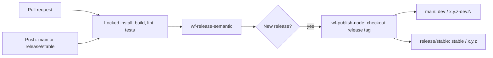

# Package delivery

The caller owns a semantic-release configuration with `release/stable` on channel `stable` and `main` on channel `preview`, prerelease `preview`.
Use only the commit analyzer, release notes generator, and GitHub plugins: registry publication is a separate job after release.

Pass `new-version`, `new-tag`, and `new-channel` from the release job to `wf-publish-node.yml`.
Run publication only when `release-published == 'true'`; GITHUB_TOKEN-created releases do not need to trigger another workflow.

The publisher checks out the release tag, installs frozen dependencies with npm or pnpm, stamps `package.json`, and builds before publishing.
The platform helper is checked out from the exact reusable workflow SHA, so caller repositories do not carry duplicated release logic.

Both registries use explicit `preview` and `stable` distribution tags.
Source `publishConfig.tag` and scoped registry overrides are replaced for the publication artifact, so a dev release cannot update `latest`.

Use `registry-url: https://npm.pkg.github.com` with environment `publish-gh-npm` for GitHub Packages.
The caller grants `contents: read`, `packages: write`, and `id-token: write`; package access uses its GITHUB_TOKEN.

Use `registry-url: https://registry.npmjs.org` with environment `publish-npm` for npm.
An existing `NPM_TOKEN` can be passed as an explicit reusable-workflow secret or supplied by that environment; without a token, configure npm trusted publishing for the caller workflow and the environment.

Granting `id-token: write` enables npm provenance and trusted publishing; it does not configure the registry trust relationship.
Keep the existing npm token until that relationship has been configured and tested.

Create a real `release/stable` branch before enabling semantic-release on `main`.
Prefer the last published stable tag as its baseline; repositories with no stable tags use semantic-release's normal first-release version, rather than inventing a published release history.

Merge the shared CI PR and let its platform release advance `v1` before merging consumer PRs.
Then merge each main adoption PR, its development consolidation PR, and the stable adoption PR when stable publication is intended.

Keep stable-history backpropagation disabled during adoption, matching the portal callers.
Development consolidation is reviewed through explicit PRs; no workflow approves or merges those PRs automatically.

## Extended release policy

Set `standard-branches: true` on the shared semantic-release job.
The platform resolves real remote `release/N.x` and `release/N.N.x` branches into explicit maintenance ranges, using `maintenance-N.x` / `maintenance-N.N.x` channels that cannot move the current stable aliases.

The consumer config retains the maintenance glob `release/+([0-9])?(.{+([0-9]),x}).x` as its declaration.
The shared resolver supplies concrete ranges because prefixed branch names are not SemVer ranges by themselves.

`main` uses channel `preview` and prerelease `dev`; `release/rc` uses `rc` / `rc`; `ci` uses `ci` / `ci-do-not-use`.
Stable uses `release/stable` and channel `stable`.

Consumers use the floating `@v1` tag and must wait for this platform change to publish before merging their adoption PRs.
Promoting main to stable carries the unified workflow; a dedicated stable-sync PR is unnecessary.
