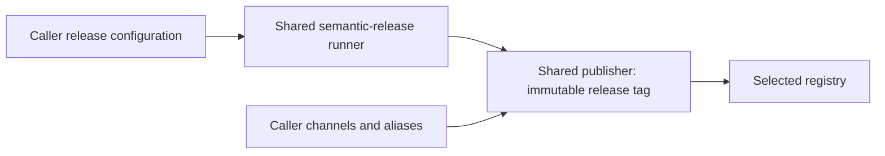

# Package delivery

The caller owns branches, maintenance ranges, channels, prerelease suffixes, and release plugins.
The shared release workflow runs that configuration without overriding its branch definitions or enforcing a release-channel policy.

Pass new-version, new-tag, and new-channel to the publishing job when release-published is true.
The package publisher checks out that tag, performs a frozen npm/pnpm install, stamps the package version, builds, and publishes in the same workflow run.

Any npm-compatible channel is supported, with any valid SemVer version; the publisher does not pair channel names with prerelease identifiers or impose maintenance ranges.
An empty semantic-release channel uses the registry default latest tag; the registry/npm client validates additional registry-specific rules.

The publisher checks version syntax, the v<version> source-tag contract, npm tag URI safety, project paths, manager support, publishable package metadata, and registry URL syntax.
The caller-selected registry/channel replace source publishConfig defaults in the publication artifact.

GitHub Packages uses the caller GITHUB_TOKEN and the publish-gh-npm environment.
Public npm uses publish-npm, with an existing NPM_TOKEN or an already-configured trusted publisher; other HTTP(S) npm registries can use NPM_TOKEN and a caller-selected environment.

Container publication accepts any valid OCI channel tag and either a release or prerelease version.
It publishes the version tags and selected channel, with no automatic latest or channel-latest aliases; callers request any additional aliases with the comma-separated additional-tags input.

Maintenance range enforcement belongs to semantic-release and the downstream configuration.
For prefixed maintenance names such as release/1.2.x, that repository must provide the explicit range 1.2.x; this platform does not discover or rename maintenance branches.

Backpropagation is optional and keyed to the caller-configured release-ref-name, not a reserved channel name.
Approval and auto-merge remain separately configurable.

Consumers reference the shared workflows through floating @v1.
Merge and release platform changes before callers rely on new inputs such as additional-tags; promoting main to stable carries the unified workflow without a separate stable-sync PR.
